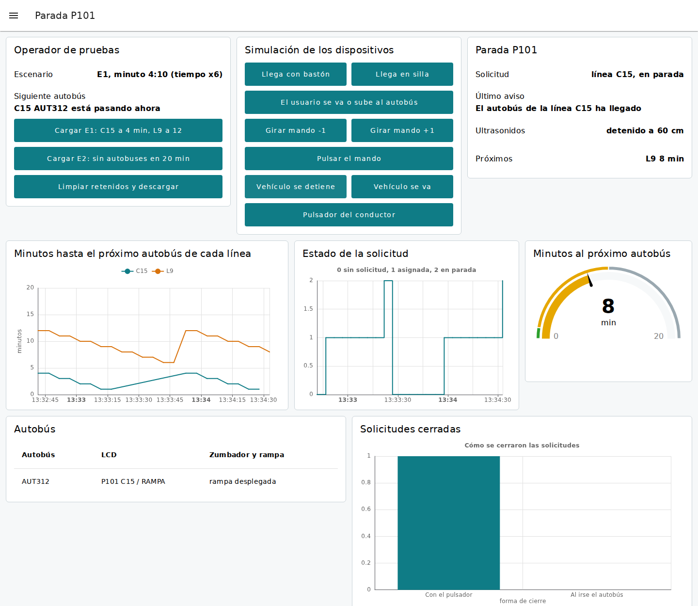
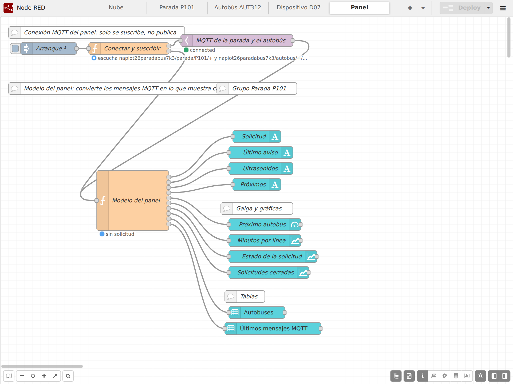

Panel del operador de la parada accesible, hecho con los nodos de Dashboard 2.0 para Node-RED (`@flowfuse/node-red-dashboard`, versión 1.37).

## 1. Qué muestra

Una sola página, «Parada P101», con nueve grupos.

| Grupo | Nodos | Qué muestra |
|---|---|---|
| Operador de pruebas | 2 text, 3 button | Reloj del escenario de horarios, cuánto falta para el siguiente autobús y los botones que cargan cada escenario |
| Simulación de los dispositivos | 9 button | Llegada y salida del usuario, giro y pulsación del mando, vehículo que se detiene o se va, pulsador del conductor |
| Parada P101 | 4 text | Solicitud y su estado, último aviso, ultrasonidos, próximos autobuses |
| Minutos hasta el próximo autobús de cada línea | chart de líneas | Una serie por línea, con un punto cada vez que la nube renueva la lista de próximos |
| Estado de la solicitud | chart en escalón | 0 sin solicitud, 1 asignada, 2 en parada |
| Minutos al próximo autobús | gauge | De 0 a 20 minutos: verde en el último minuto, ámbar hasta 10, gris el resto |
| Autobús | table | Lo que muestra el LCD y estado del zumbador y la rampa |
| Solicitudes cerradas | chart de barras | Cuántas solicitudes se han cerrado y cómo: con el pulsador del conductor o al irse el autobús |
| Últimos mensajes MQTT | table | Los 12 últimos mensajes, con hora, origen y contenido |

## 2. Cómo encaja en la arquitectura

El dashboard es el «usuario remoto, operador de pruebas» que el diseño tenía como propuesta. Respeta la misma regla que el resto: las pestañas solo se comunican por MQTT.

- **La parte que muestra datos está en una pestaña propia, «Panel».** Tiene su conexión MQTT y solo se suscribe, no publica nada. Un nodo function, «Modelo del panel», reconstruye el estado del sistema con los mensajes que oye (`solicitud`, `aviso`, `deteccion`, `proximos`, y los `asistencia`, `orden` y `evento` del autobús) y lo reparte a los widgets. No lee el contexto de ninguna otra pestaña, así que seguirá funcionando igual cuando la parada y los autobuses sean hardware real.
- **Cada botón vive en la pestaña del dispositivo que maneja**, conectado al mismo nodo que su inject. Los botones de los escenarios están en la pestaña Nube, los del mando y el vehículo en la pestaña Parada, y así con todos. Cuando una pestaña virtual se sustituya por hardware, sus botones desaparecen con ella.
Pestaña Panel: la entrada MQTT a la izquierda, el modelo en el centro y los widgets a la derecha.

- **El reloj del escenario** sale del gestor de solicitudes de la nube, dentro de su misma pestaña.

No se ha cambiado ningún topic ni payload.

Lo que el panel no puede saber, porque no viaja por MQTT: si hay un usuario en la parada antes de que pida una línea, la distancia que mide el ultrasonidos en cada muestra (solo se publica cuando un vehículo se detiene o se va) el texto exacto que dice el altavoz (muestra el aviso que lo provoca) y el tiempo de Open Weather Map (ejercicio 4), que se queda en la parada.

## 3. Instalación

`datos_nodered/package.json` declara la dependencia de `@flowfuse/node-red-dashboard`. Hay que ejecutar `npm install` dentro de `datos_nodered` la primera vez.

## 4. Pruebas realizadas

Con un navegador sin interfaz, abriendo el dashboard y pulsando sus propios botones:

| Prueba | Resultado |
|---|---|
| Carga de la página en escritorio (1440 px) y en móvil (420 px) | Correcto, sin errores en la consola del navegador |
| Caso principal completo desde el dashboard: cargar E1, llegar con bastón, girar y pulsar el mando, detener el vehículo, pulsador del conductor | Correcto. La solicitud se cierra con el pulsador y la barra correspondiente sube |
| Caso en silla de ruedas desde el dashboard, sin pulsador | Correcto. El LCD muestra `RAMPA`, la rampa se despliega y se recoge al irse el autobús |
| Las tres gráficas, la galga y las dos tablas reciben datos | Correcto, comprobado en capturas de pantalla |

Sin probar: el dashboard en GitHub Codespaces y con varios navegadores abiertos a la vez.
