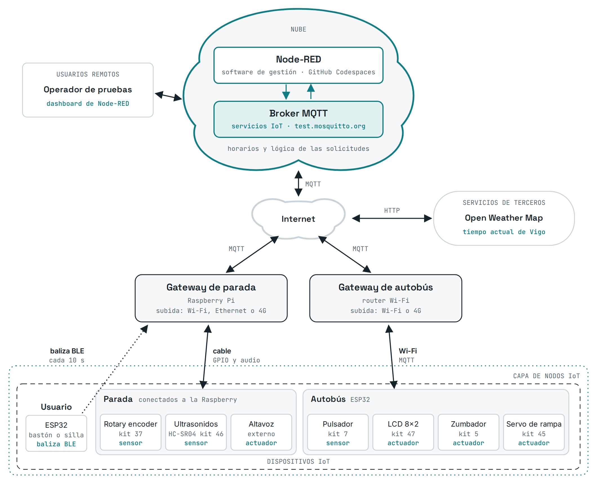
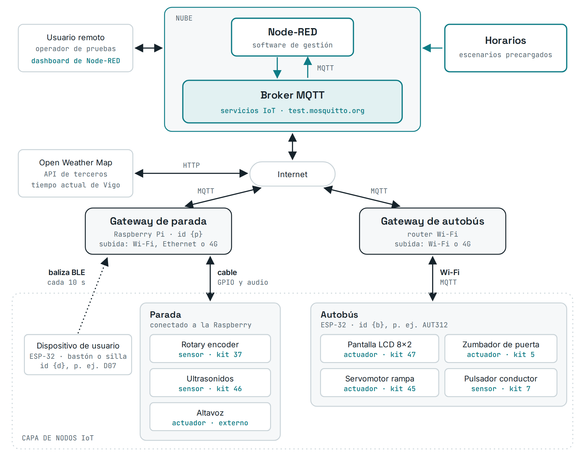
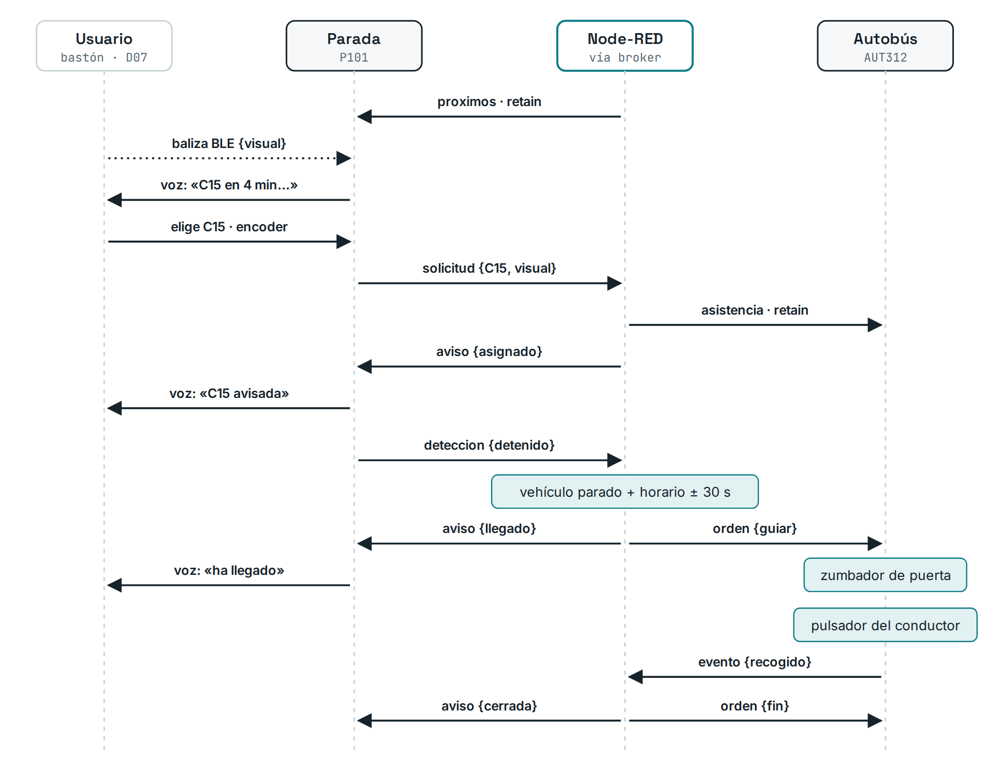
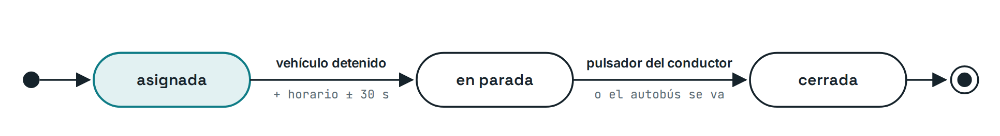

Punto 1 del ejercicio: diseño de la arquitectura de Cloud Computing y descripción de sus capas.

## El proyecto

Una parada de autobús accesible. Una persona ciega o en silla de ruedas lleva un dispositivo pequeño en el bastón o en la silla. La parada lo detecta, le dice por voz qué autobuses están al llegar y avisa al que el usuario elija. El autobús llega sabiendo qué ayuda tiene que dar: hace sonar un zumbador en la puerta o despliega la rampa.

1. El usuario llega a la parada. Su dispositivo le indica a la parada qué tipo de asistencia necesita.
2. La parada dice por voz qué autobuses pasarán en los próximos 20 minutos. El usuario gira un mando para pasar de una línea a otra y pulsa cuando oye la suya.
3. Si llueve, nieva o ha llovido hace poco, la parada avisa además de que el suelo puede estar resbaladizo.
4. El sistema avisa al siguiente autobús de esa línea. El conductor ve en su pantalla que hay alguien esperando y qué ayuda necesita.
5. El autobús se detiene en la parada. La parada lo dice por voz, y en el autobús suena el zumbador (asistencia visual) o se despliega la rampa (movilidad).
6. El conductor pulsa un botón cuando la persona ha subido. Si no pulsa, la solicitud se cierra igual cuando el autobús se va.

## Arquitectura

El mismo diseño con más detalle, tal como lo usamos para trabajar:

El diseño completo, con supuestos, casos de uso, requisitos y ampliaciones previstas, está en `docs/Arquitectura_Parada_Autobus_base.html`, en el repositorio.

## Capas

| Capa | Qué contiene | Qué hace |
|---|---|---|
| Nodos IoT | El dispositivo del usuario (ESP32 con baliza BLE), los sensores y el altavoz de la parada, y el ESP32 del autobús con su pantalla, zumbador, servo y pulsador | Miden y actúan. No toman decisiones |
| Gateways | En la parada, una Raspberry Pi. En el autobús, un router Wi-Fi | Llevan los datos de los nodos a Internet. La Raspberry recibe además la baliza BLE y controla por cable sus sensores y el altavoz |
| Internet | La conexión entre los gateways y la nube | Todo viaja por MQTT |
| Nube | El broker MQTT (test.mosquitto.org) y Node-RED, desplegado en GitHub Codespaces | El broker reparte los mensajes. Node-RED tiene los horarios y toda la lógica: a qué autobús avisar, cuándo ha llegado y cuándo se cierra la solicitud |
| Servicios externos | Open Weather Map, una API de terceros | Da por HTTP el tiempo actual de Vigo, que se convierte en un aviso de suelo mojado |
| Usuario remoto | El operador, con un dashboard de Node-RED | Ve el estado del sistema y lanza las pruebas |

La parada y el autobús no se conocen entre sí. Todo pasa por el broker, y la lógica está solo en Node-RED. El autobús no envía su posición: cuánto le falta para llegar sale de los horarios, y el ultrasonidos de la parada lo confirma.

## Sensores y actuadores

Tres sensores y cuatro actuadores. Todos salen del kit Keyestudio 48 en 1 menos el altavoz.

| Tipo | Componente | N.º de kit | Dónde | Para qué |
|---|---|---|---|---|
| Sensor | Rotary encoder | 37 | Parada | El usuario recorre las líneas y pulsa para elegir |
| Sensor | Ultrasonidos HC-SR04 | 46 | Parada | Detecta cuándo un vehículo se detiene y cuándo se va |
| Sensor | Pulsador | 7 | Autobús | El conductor confirma que la persona ha subido |
| Actuador | LCD 0802 | 47 | Autobús | Muestra parada, línea y tipo de asistencia |
| Actuador | Zumbador activo | 5 | Autobús | Suena en la puerta para guiar al usuario con bastón |
| Actuador | Servo 9G | 45 | Autobús | Despliega y recoge la rampa |
| Actuador | Altavoz (externo) | | Parada | Dice los autobuses, la línea al girar el mando y los avisos |

## Secuencia de una solicitud

La flecha punteada es BLE y va directa del dispositivo a la parada. Las demás pasan por el broker.

## Estados de una solicitud

La solicitud pasa a «en parada» solo con doble verificación: el ultrasonidos ve un vehículo detenido y, según los horarios, al autobús avisado le toca llegar en ese momento.

Los mensajes MQTT que intercambian las capas están en [Implementación de la arquitectura](Implementación-de-la-arquitectura).
