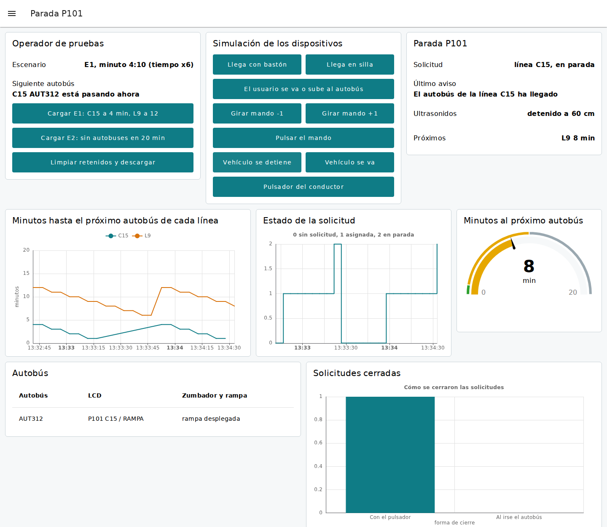

# Parada de autobús accesible

Práctica 1 de Novas Arquitecturas e Paradigmas IoT: arquitectura de Cloud Computing con Node-RED y MQTT.

Una persona ciega o en silla de ruedas lleva una baliza en el bastón o en la silla. La parada la detecta, anuncia por voz los autobuses que vienen y avisa al que el usuario elige, que al llegar hace sonar un zumbador en la puerta o despliega la rampa.

| Punto del ejercicio | Página |
|---|---|
| 1. Diseño de la arquitectura y descripción de las capas | [Diseño de la arquitectura](Diseño-de-la-arquitectura) |
| 2. Implementación: Node-RED, nodos IoT virtuales y MQTT | [Implementación de la arquitectura](Implementación-de-la-arquitectura) |
| 3. Dashboard con Dashboard 2.0 | [Dashboard](Dashboard) |
| 4. Integración de Open Weather Map | [Open Weather Map](Open-Weather-Map) |

## Cómo arrancarlo en GitHub Codespaces

1. En el repositorio, botón Code, pestaña Codespaces, Create codespace on main.
2. En el terminal del codespace:

```bash
npm install -g --unsafe-perm node-red
(cd datos_nodered && npm install)
node-red --userDir ./datos_nodered
```

3. En la pestaña Ports, abre en el navegador la dirección del puerto 1880. Es el editor de Node-RED.
4. Añade `/dashboard` al final de esa dirección para ver el dashboard. Desde él se hace toda la prueba con botones.

Los flujos están en `datos_nodered/flows.json` y los pasos de cada prueba en el `README.md` del repositorio.


