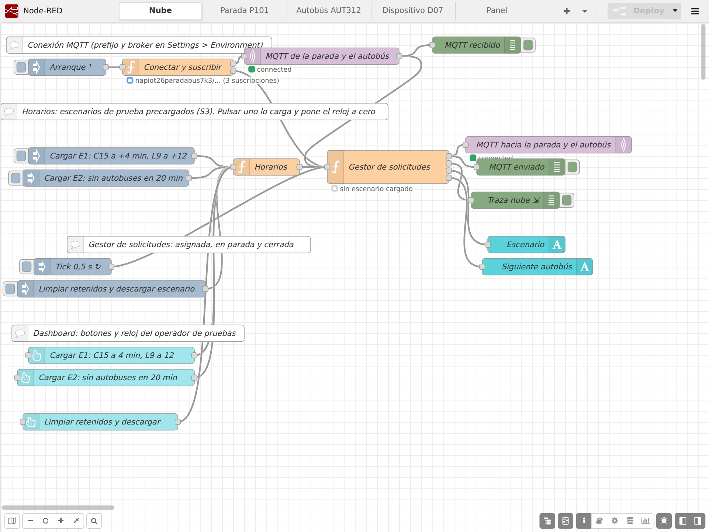
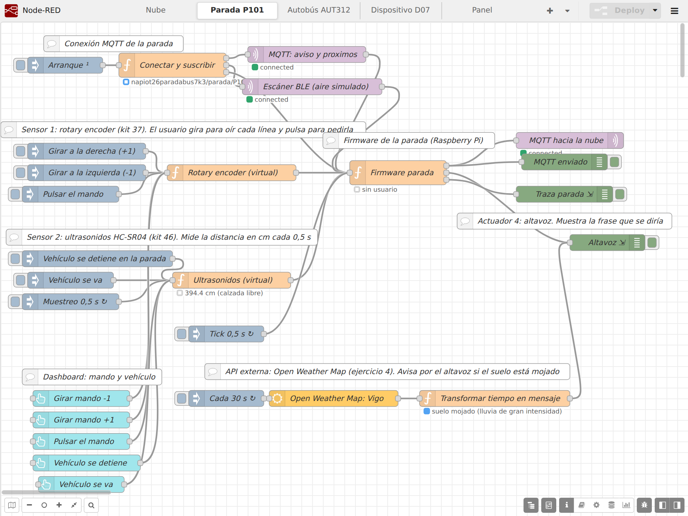
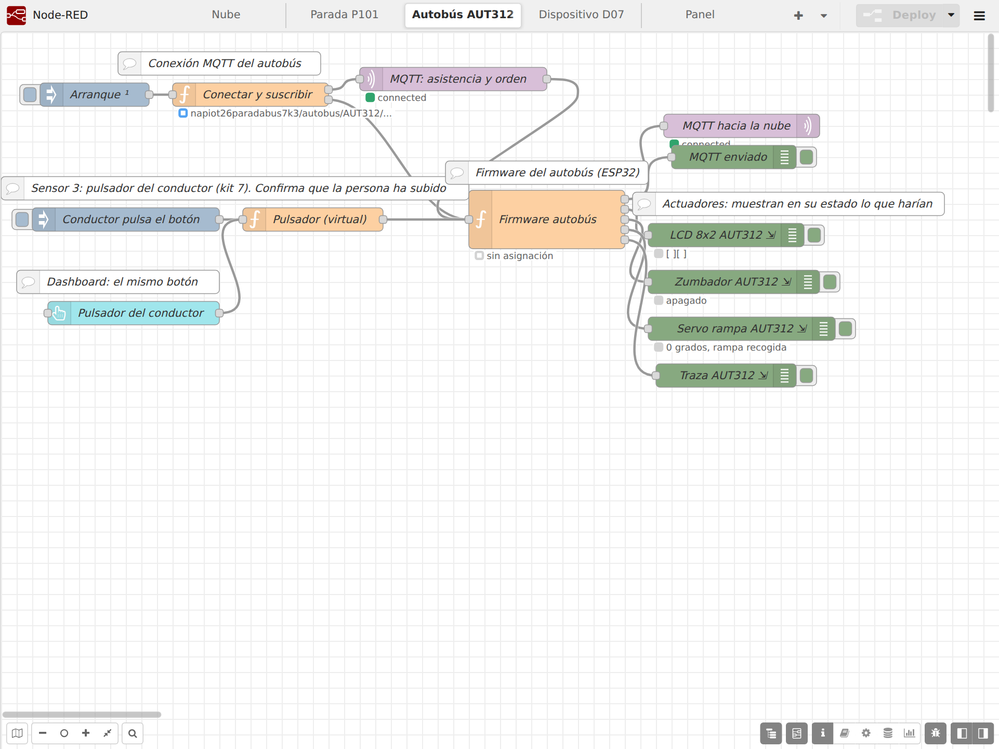
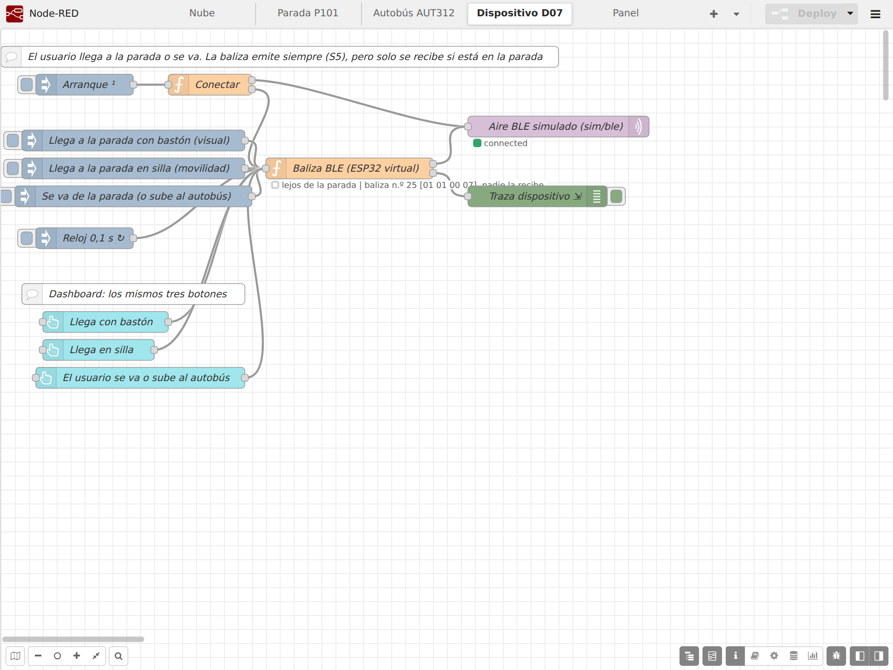

Parada de autobús accesible: implementación en Node-RED del diseño base, con los nodos IoT simulados y MQTT como integración entre capas. El diseño está en la página [Diseño de la arquitectura](Diseño-de-la-arquitectura).

## 1. Qué se ha implementado

| Capa del diseño | Cómo se ha implementado |
|---|---|
| Nube | Node-RED (en local durante el desarrollo, en GitHub Codespaces para la entrega). Contiene los horarios precargados y el gestor de solicitudes |
| Integración entre capas | MQTT sobre el broker público test.mosquitto.org, puerto 1883, sin usuario ni TLS |
| Capa de nodos IoT | Sensores y actuadores virtuales dentro del propio Node-RED, según el Anexo del enunciado: un nodo inject, un nodo function que genera el dato y un nodo mqtt out |

## 2. Pestañas

Cada pieza del sistema es una pestaña con su propia conexión MQTT. Las pestañas no comparten cables, nodos link ni contexto global: solo se comunican por el broker. Así, cuando haya hardware, se desactiva la pestaña virtual y la nube no cambia.

| Pestaña | Sustituye a | Sensores virtuales | Actuadores representados |
|---|---|---|---|
| Nube | Nada, es la nube real | | |
| Parada P101 | Raspberry Pi (gateway de parada) | Rotary encoder (kit 37), ultrasonidos HC-SR04 (kit 46), escáner BLE. Además consulta Open Weather Map (ejercicio 4) | Altavoz |
| Autobús AUT312 | ESP32 del autobús | Pulsador del conductor (kit 7) | LCD 0802 (kit 47), zumbador (kit 5), servo de la rampa (kit 45) |
| Dispositivo D07 | ESP32 del bastón o la silla | Baliza BLE | |
| Panel | Nada, es el dashboard (ejercicio 3) | | |

Para añadir otro autobús se duplica su pestaña y se cambia la variable de entorno `BUS_ID`.

Pestaña Nube: a la izquierda los botones que cargan los horarios, en el centro el gestor de solicitudes y a la derecha la salida MQTT.

Pestaña Parada P101: los dos sensores virtuales a la izquierda, el firmware en el centro y el altavoz a la derecha.

Pestaña Autobús AUT312: el pulsador del conductor a la izquierda y los tres actuadores a la derecha.

Pestaña Dispositivo D07: la baliza BLE del bastón o la silla.

### 2.1 Qué dato da cada sensor virtual

| Sensor | Nodos | Dato |
|---|---|---|
| Rotary encoder | 3 inject (girar +1, girar -1, pulsar) y una function | `{ giro: +1 }`, `{ giro: -1 }` o `{ pulsado: true }` |
| Ultrasonidos | inject de muestreo cada 0,5 s, 2 inject que ponen o quitan un vehículo y una function | Distancia en cm: unos 60 cm con vehículo, unos 395 cm sin él, con ruido |
| Pulsador del conductor | 1 inject y una function | Una pulsación |
| Baliza BLE | inject de reloj y una function | 4 bytes cada 10 s: versión, tipo (1 visual, 2 movilidad) e id en 16 bits. Para D07: `01 01 00 07` |

El encoder y el ultrasonidos van conectados por cable a la Raspberry, así que su dato en bruto no sale al broker. Lo recibe el nodo «Firmware parada», que hace lo que hará la Raspberry: convierte los giros en un menú por voz y la distancia en un mensaje `deteccion`, que lleva dentro la distancia medida.

### 2.2 Cómo se ven los actuadores

Cada actuador es un nodo debug que muestra bajo el nodo lo que haría, y lo escribe también en la consola de Node-RED.

| Actuador | Ejemplo de lo que muestra |
|---|---|
| Altavoz | `Su autobús de la línea C15 ha llegado.` |
| LCD 8x2 | `[P101 C15][VISUAL  ]` (dos líneas de 8 caracteres) |
| Zumbador | `SONANDO` o `apagado` |
| Servo de la rampa | `90 grados, rampa desplegada` o `0 grados, rampa recogida` |

### 2.3 La baliza BLE

El BLE real no pasa por el broker. Como las pestañas solo pueden hablar por MQTT, la radio se simula con un topic aparte, `{prefijo}/sim/ble/P101`, que lleva los mismos 4 bytes que el anuncio real. La nube no se suscribe a él. Cuando haya hardware, ese topic desaparece y lo sustituye el escáner Bluetooth de la Raspberry.

## 3. Configuración

Está en un único sitio: las variables de entorno globales de Node-RED (Settings, Environment), que se guardan dentro de `flows.json`.

| Variable | Valor |
|---|---|
| `TOPIC_PREFIX` | `napiot26paradabus7k3` |
| `MQTT_BROKER` | `test.mosquitto.org` |
| `MQTT_PORT` | `1883` |
| `FACTOR_TIEMPO` | `6` |
| `OPENWEATHER_API_KEY` | La API key de Open Weather Map (ejercicio 4) |

Ningún nodo mqtt lleva el topic escrito. Cada pestaña tiene un nodo «Conectar y suscribir» que, al arrancar, lee el prefijo, conecta con el broker y hace las suscripciones.

`FACTOR_TIEMPO` acelera los tiempos del diseño sin tocar la lógica: la nube usa un reloj de escenario que avanza más rápido, y la parada y el dispositivo dividen sus periodos. Con factor 6, la baliza sale cada 1,7 s, la ausencia son 20 s y el margen de los horarios es de 5 s. Con factor 1 son los tiempos reales.

## 4. Topics y payloads

Todos llevan delante `napiot26paradabus7k3/`. `{p}` es la parada y `{b}` el autobús. Todos van con QoS 1.

| Topic | Dirección | Retain | Payload |
|---|---|---|---|
| `parada/{p}/proximos` | nube a parada | Sí | `{ ts, buses: [{ linea, min }] }` |
| `parada/{p}/solicitud` | parada a nube | No | `{ solicitud, linea, asistencia }` |
| `parada/{p}/deteccion` | parada a nube | No | `{ estado: "detenido" o "libre", distancia_cm }` |
| `parada/{p}/aviso` | nube a parada | No | `{ tipo, linea, solicitud }`, con `tipo` en `asignado`, `llegado`, `cerrada` |
| `autobus/{b}/asistencia` | nube a autobús | Sí | `{ solicitud, parada, linea, asistencia }`, o vacío si no hay solicitud |
| `autobus/{b}/orden` | nube a autobús | No | `{ tipo, solicitud }`, con `tipo` en `guiar`, `rampa`, `fin` |
| `autobus/{b}/evento` | autobús a nube | No | `{ tipo: "recogido", solicitud }` |
| `sim/ble/{p}` | dispositivo a parada | No | 4 bytes. Solo simulación |

En un broker público no viaja ningún dato personal, solo el tipo de asistencia.

## 5. Lógica de nube

Los horarios son escenarios de prueba precargados en el nodo «Horarios». Cada paso fija línea, parada, autobús y minuto de paso, contado desde que se carga el escenario.

| Escenario | Pasos por P101 | Para probar |
|---|---|---|
| E1 | C15 con AUT312 a +4 min, L9 con AUT205 a +12 min | El recorrido completo |
| E2 | C15 con AUT312 a +26 min | Parada sin autobuses en 20 min |

Un único nodo function, «Gestor de solicitudes», contiene la máquina de estados:

| Estado | Entra cuando | Qué hace la nube |
|---|---|---|
| `asignada` | La parada publica una solicitud | Avisa al siguiente autobús de esa línea (asignación retenida) y envía `aviso asignado` |
| `en_parada` | El ultrasonidos detecta un vehículo detenido y, según los horarios, al autobús avisado le toca llegar (margen de 30 s) | `aviso llegado` y `orden guiar` o `rampa` |
| cerrada | El conductor pulsa, o el vehículo se va | `orden fin`, borra la asignación y envía `aviso cerrada` |

Además, cada 30 s publica retenida la lista de próximos autobuses de cada parada.

AUT205 no tiene pestaña: existe solo en los horarios, para que el menú de la parada tenga dos líneas.

## 6. Diferencias respecto al diseño base

1. **Prefijo.** Todos los topics llevan delante `napiot26paradabus7k3/`, porque el broker es público.
2. **BLE simulado.** Topic `sim/ble/{p}` en lugar de radio (apartado 2.3).
3. **Tiempos acelerados.** Variable `FACTOR_TIEMPO`, solo para probar.
4. **Autobús no detectado.** El diseño supone que el ultrasonidos no falla. En la simulación el autobús lo mueve una persona con un botón, así que, si se pasa el margen sin detección, la solicitud se cierra para no quedarse colgada.
5. **Limpieza de retenidos.** Al cargar un escenario, la nube borra las asignaciones retenidas que pudieran quedar de una ejecución anterior.

## 7. Pruebas realizadas

Hechas en local con Node-RED 5.0.10, contra test.mosquitto.org y con factor de tiempo 6. Los botones se pulsaron con un guion, y se comprobó el resultado en las trazas y en el tráfico MQTT registrado con `mosquitto_sub`.

| Caso | Resultado |
|---|---|
| Principal: bastón, línea C15, AUT312 llega, zumbador, el conductor confirma | Correcto. No queda ninguna asignación retenida |
| Cierre sin pulsador: silla, rampa, el autobús se va | Correcto. La rampa se recoge y la solicitud se cierra |
| Sin autobuses | Correcto. La parada lo dice y no se publica solicitud |

Sin probar en esta versión: la segunda pulsación del mando con una solicitud activa, el cierre por autobús no detectado y el funcionamiento en GitHub Codespaces.

El 20/11/2026 se repitieron los tres casos con Open Weather Map ya integrado, con el mismo resultado.

Cómo repetirlas: ver el `README.md` del repositorio.
