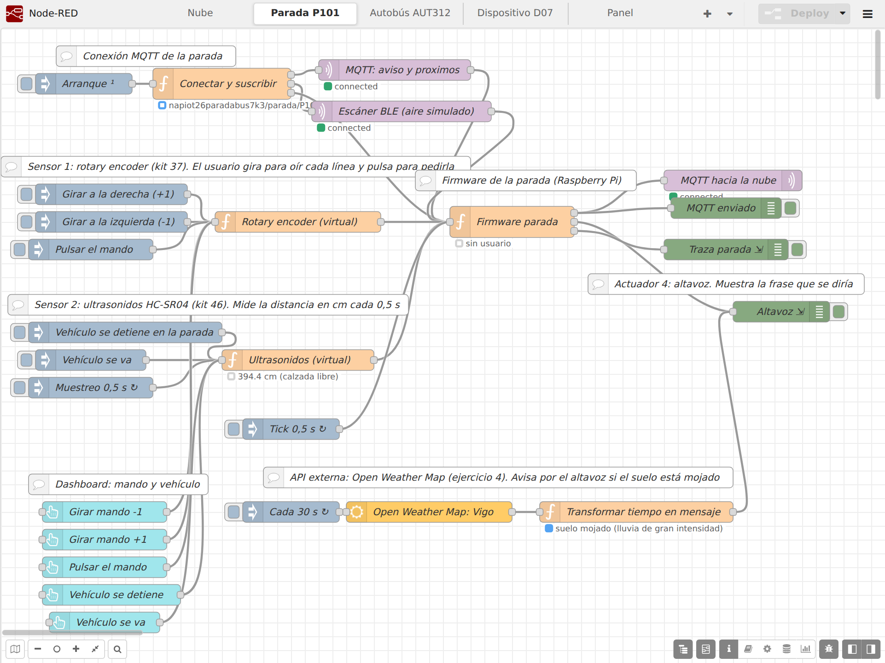

Integración de una API de terceros en la solución: la parada consulta el tiempo actual de Vigo en Open Weather Map y, si el suelo puede estar mojado, lo avisa por el altavoz.

## 1. Para qué sirve en nuestro sistema

Los usuarios de la parada son personas ciegas o en silla de ruedas. Un suelo mojado o helado es un riesgo real al subir al autobús o al usar la rampa, y ellos no siempre pueden verlo. El dato del tiempo se convierte en un aviso por voz, que es el único canal que la parada tiene con el usuario.

| Caso de uso | Requisito | Se cubre con |
|---|---|---|
| CU6: saber que el suelo está mojado | RF9: la parada avisa por voz si el suelo puede estar mojado o helado | Open Weather Map (tiempo actual de Vigo) y el altavoz |

## 2. Pasos seguidos

Son los del apartado 4 del enunciado.

1. Alta en https://openweathermap.org y copia de la API key desde la sección API keys.
2. En Node-RED, menú Manage Palette, instalación de `node-red-node-openweathermap` (versión 1.0.1). Queda declarado en `datos_nodered/package.json`, así que en una instalación nueva basta con `npm install`.
3. Nodo `openweathermap` añadido a la pestaña «Parada P101» y configurado así:

| Campo | Valor |
|---|---|
| Tipo de consulta | Tiempo actual (`current`) |
| Ciudad y país | Vigo, Spain |
| Idioma | `es` |
| API key | `${OPENWEATHER_API_KEY}` |

La API key no está escrita en el nodo. Es una variable de entorno más de Node-RED (Settings, Environment), junto al prefijo de los topics y el broker, de modo que toda la configuración sigue en un único sitio.

## 3. El flujo

Son tres nodos, abajo a la derecha de la pestaña:

| Nodo | Tipo | Qué hace |
|---|---|---|
| Cada 30 s | inject | Lanza una consulta al arrancar y después cada 30 segundos |
| Open Weather Map: Vigo | openweathermap | Pregunta a la API por HTTP y devuelve el tiempo actual |
| Transformar tiempo en mensaje | function | Decide si hay que avisar y con qué frase. Su salida va al nodo «Altavoz» |

El nodo de Open Weather Map entrega un resumen en `msg.payload` (descripción, temperatura en grados, humedad) y la respuesta completa de la API en `msg.data`. La función usa el código de condición (`weather[0].id`), la lluvia acumulada (`rain`) y la temperatura:

| Condición | Frase por el altavoz |
|---|---|
| Código 6xx (nieve) | «Atención: está nevando, el suelo puede estar resbaladizo.» |
| Código 2xx (tormenta) | «Atención: hay tormenta, el suelo está mojado. Tenga cuidado al subir al autobús.» |
| Código 3xx o 5xx (llovizna o lluvia) | «Atención: está lloviendo, el suelo puede estar resbaladizo. Tenga cuidado al subir al autobús.» |
| Sin lluvia ahora, pero con lluvia acumulada en la última hora | «Atención: ha llovido recientemente, el suelo puede estar mojado.» |
| Cualquiera de las anteriores con 0 grados o menos | Se añade «Puede haber hielo.» |
| Ninguna | No dice nada |

Dos reglas evitan que el aviso moleste:

- Solo se dice si hay un usuario en la parada (la parada lo sabe por la baliza BLE).
- Se dice una vez por usuario, no en cada consulta.

Bajo el nodo de la función se ve siempre el resultado de la última consulta, por ejemplo `suelo mojado (lluvia de gran intensidad)` o `suelo seco (cielo claro)`.

## 4. Cómo encaja en la arquitectura

- En el diseño, Open Weather Map es un servicio externo conectado a Internet, al mismo nivel que el broker: se le pregunta por HTTP y no usa MQTT.
- La consulta está en la pestaña de la parada, que es quien tiene el altavoz y quien sabe si hay un usuario. No cruza a ninguna otra pestaña, así que se mantiene la regla de que las pestañas solo se comunican por MQTT.
- No se ha añadido ni cambiado ningún topic ni payload.

Con hardware real hay dos opciones: que la Raspberry Pi de la parada haga la misma consulta, o mover la consulta a la nube y enviar el aviso a la parada por un topic nuevo. La segunda deja la API key fuera de los dispositivos y permitiría mostrar el tiempo en el dashboard.

## 5. Pruebas realizadas

Hechas en local el 20/11/2026, con lluvia real en Vigo.

| Prueba | Resultado |
|---|---|
| Arranque con la API key correcta | El nodo de la función muestra `suelo mojado (lluvia de gran intensidad)`. Sin errores en la consola |
| Llega un usuario con lluvia | Además de la lista de autobuses, el altavoz dice «Atención: está lloviendo, el suelo puede estar resbaladizo. Tenga cuidado al subir al autobús.» |
| El aviso no se repite | Con el mismo usuario en la parada, las consultas siguientes no vuelven a decirlo |
| API key incorrecta | La consola muestra `Invalid API Key provided`, como indica el enunciado, y el resto del sistema sigue funcionando |
| El resto de casos (bastón, silla de ruedas, sin autobuses) | Siguen funcionando igual que antes de añadir el tiempo |

## 6. Limitaciones conocidas

1. **El aviso puede tardar hasta 30 segundos.** Se dice cuando toca la siguiente consulta, no en el momento en que llega el usuario. En las pruebas tardó entre 2 y 22 segundos.
2. **Dos usuarios muy seguidos.** Si un usuario se va y otro llega antes de que pase una consulta completa sin nadie en la parada, el segundo no oye el aviso.
3. **El dashboard no muestra el tiempo.** El dato no viaja por MQTT, y el panel solo ve lo que pasa por el broker.
4. **La API key está en `flows.json`.** Es cómodo para la práctica, pero cualquiera que pueda leer el repositorio puede leerla. Es una clave gratuita y se puede regenerar en la web de Open Weather Map.
